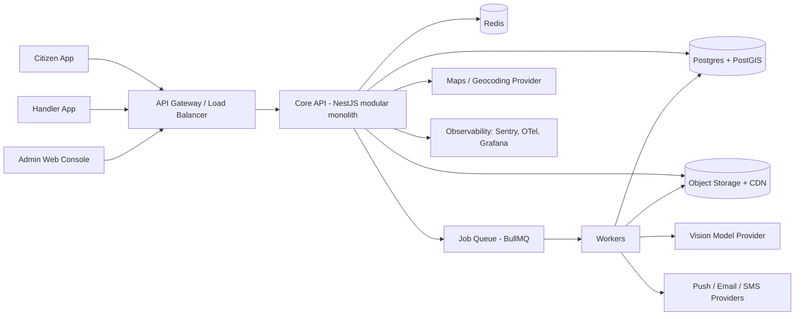

# 02. System Architecture

## 1. Principles
1. Modular monolith first, with clear module boundaries so any module can be extracted later.
2. Tenant-aware everywhere: tenant context is resolved once per request and enforced in the database.
3. Config over code for anything that varies by geography.
4. Async by default for slow work (AI, media, notifications).
5. Managed services over self-hosting. Buy rather than build auth, maps, payments, SMS.

## 2. Context diagram


## 3. Components
| Component | Responsibility |
|---|---|
| Citizen app (React Native, Expo) | Report, request pickup, track, confirm |
| Handler app (same codebase, role-gated) | Tasks, navigation handoff, proof upload |
| Admin web (Next.js + TypeScript) | Tenant and platform consoles |
| Core API (NestJS) | Auth, tenants, tickets, routing, SLA, notifications orchestration |
| Workers (Node, BullMQ) | Verification pipeline, media processing, notifications, SLA timers |
| Postgres + PostGIS | System of record, geo queries, RLS |
| Redis | Queues, rate limits, caching, locks |
| Object storage + CDN | Original and anonymised media, signed URLs |

## 4. Modules (inside the monolith)
`identity` · `tenancy` · `geo` · `tickets` · `verification` · `routing` · `sla` · `assignments` · `media` · `notifications` · `analytics` · `admin` · `audit`

Rules: modules talk through service interfaces and domain events, never by reading each other's tables directly.

## 5. Multi-tenancy
- **Model:** shared database, shared schema, `tenant_id` on every tenant-owned table.
- **Enforcement:** Postgres Row-Level Security. Each request sets `SET LOCAL app.tenant_id = '<uuid>'` inside its transaction.
- **Resolution order:** JWT claim `tid` → `X-Tenant-Id` header (validated against membership) → geo lookup for anonymous reports.
- **Upgrade path:** large tenants can later move to a dedicated schema or database by `tenant_id`. The code path uses a tenant-connection resolver to make that possible.

## 6. Geo and routing design
- Regions form a hierarchy (`country → region → city → zone`) stored as PostGIS `MULTIPOLYGON` (SRID 4326), with GiST indexes.
- Authorities own one or more regions. Overlaps resolve by `priority` then `specificity` (smaller area wins), deterministically.
- Routing steps: (1) resolve tenant and region from the point, (2) choose the authority, (3) pick a team by category capability, (4) rank handlers by proximity and open load, (5) create an assignment and start the SLA clock.
- Reports outside every tenant polygon are held as `UNSERVED` and counted as demand signal for expansion.

## 7. Ticket pipeline (async)
```
Upload → media.process (strip EXIF to a side-table, blur faces/plates, thumbnails)
       → verification.run (classify, authenticity, dedupe)
       → routing.assign
       → notifications.send
SLA scheduler (every 30 s) → breach check → escalation events
```
All steps are idempotent, with retries (exponential backoff), a dead-letter queue, and an event written per transition.

## 8. Tech stack (decisions)
| Layer | Choice |
|---|---|
| Mobile | React Native (Expo), TypeScript |
| Web | Next.js, TypeScript, Tailwind |
| API | NestJS, TypeScript, OpenAPI generated |
| DB | PostgreSQL 16 + PostGIS 3 |
| Cache/queue | Redis 7 + BullMQ |
| Storage | S3-compatible with CloudFront or equivalent CDN |
| Auth | Managed provider (e.g., Auth0, Clerk or Cognito) with phone OTP |
| Maps | Mapbox or Google Maps, behind a `MapsProvider` interface |
| AI | Hosted vision model behind a `VisionProvider` interface |
| Notifications | FCM/APNs, SES or equivalent, Twilio or local SMS gateway (adapter) |
| Infra | Docker, Terraform, a single cloud region at launch |
| CI/CD | GitHub Actions |
| Observability | Sentry, OpenTelemetry, Grafana/Prometheus |

## 9. Architecture decision records
| ADR | Decision | Reason | Revisit when |
|---|---|---|---|
| 001 | Modular monolith | Solo/small team, faster delivery | A module needs independent scaling |
| 002 | Postgres + PostGIS | Strong geo, transactions, RLS | Geo load exceeds a single primary |
| 003 | Shared schema + RLS | Cheapest for many small tenants | Enterprise tenant needs isolation |
| 004 | Hosted vision model first | No labeled data yet | 5-10k labeled images collected |
| 005 | Provider interfaces for maps/vision/SMS/payments | Different countries need different vendors | Never. This is permanent |
| 006 | React Native | One codebase, strong ecosystem | Heavy native camera needs |
| 007 | Event-sourced ticket history (append-only) | Audit and analytics | Never |

## 10. Scalability and resilience
- Stateless API behind a load balancer, with autoscaling on CPU and request rate.
- Read replica for analytics and heatmaps once load requires it.
- Partition `ticket_events` by month. Cache tenant config in Redis (invalidate on change).
- Graceful degradation: if the vision provider is down, tickets go to `NEEDS_REVIEW` and the loop continues.
- Backups: PITR on Postgres, versioned object storage. RPO 15 min, RTO 2 h.

## 11. Data residency
Tenants carry a `data_region` attribute. MVP runs one region. The design allows regional stacks (EU, India, US) with the same code, with a control-plane directory mapping tenant → region.

## 12. Environments
`local` → `dev` → `staging` (production-like, anonymised data) → `production`. Every environment is created from the same Terraform modules.
