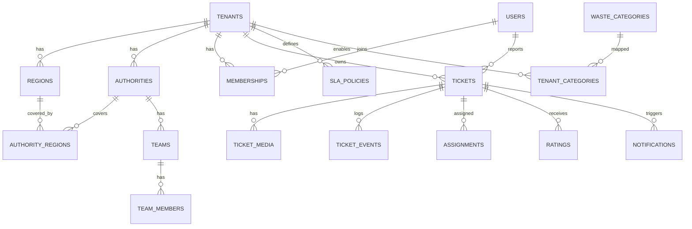

# 03. Database Design

**Engine:** PostgreSQL 16 + PostGIS 3. **Conventions:** UUIDv7 primary keys, `timestamptz` in UTC, snake_case, soft-delete via `deleted_at` where needed, money as `bigint` minor units + `char(3)` currency.

## 1. Entity-relationship overview


## 2. Core DDL
```sql
CREATE EXTENSION IF NOT EXISTS postgis;
CREATE EXTENSION IF NOT EXISTS pgcrypto;

-- Tenancy -----------------------------------------------------------
CREATE TABLE tenants (
  id            uuid PRIMARY KEY,
  slug          text UNIQUE NOT NULL,
  name          text NOT NULL,
  country_code  char(2) NOT NULL,
  default_locale text NOT NULL DEFAULT 'en',
  time_zone     text NOT NULL,              -- IANA
  currency      char(3) NOT NULL,
  data_region   text NOT NULL DEFAULT 'primary',
  config        jsonb NOT NULL DEFAULT '{}', -- validated against 06 schema
  status        text NOT NULL DEFAULT 'draft' CHECK (status IN ('draft','active','suspended')),
  created_at    timestamptz NOT NULL DEFAULT now()
);

CREATE TABLE regions (
  id          uuid PRIMARY KEY,
  tenant_id   uuid NOT NULL REFERENCES tenants(id),
  parent_id   uuid REFERENCES regions(id),
  level       text NOT NULL CHECK (level IN ('country','region','city','zone')),
  name        text NOT NULL,
  geom        geometry(MultiPolygon,4326) NOT NULL,
  created_at  timestamptz NOT NULL DEFAULT now()
);
CREATE INDEX regions_geom_gix ON regions USING gist (geom);
CREATE INDEX regions_tenant_ix ON regions (tenant_id);

-- Identity ----------------------------------------------------------
CREATE TABLE users (
  id            uuid PRIMARY KEY,
  external_auth_id text UNIQUE,
  display_name  text,
  email         citext, phone text,
  locale        text NOT NULL DEFAULT 'en',
  is_anonymous  boolean NOT NULL DEFAULT false,
  reputation    numeric(4,2) NOT NULL DEFAULT 1.00,
  created_at    timestamptz NOT NULL DEFAULT now(),
  deleted_at    timestamptz
);

CREATE TABLE memberships (
  id         uuid PRIMARY KEY,
  tenant_id  uuid NOT NULL REFERENCES tenants(id),
  user_id    uuid NOT NULL REFERENCES users(id),
  role       text NOT NULL CHECK (role IN ('citizen','handler','supervisor','tenant_admin')),
  UNIQUE (tenant_id, user_id, role)
);

-- Authorities and teams ---------------------------------------------
CREATE TABLE authorities (
  id         uuid PRIMARY KEY,
  tenant_id  uuid NOT NULL REFERENCES tenants(id),
  name       text NOT NULL,
  kind       text NOT NULL CHECK (kind IN ('municipal','private','ngo')),
  priority   int  NOT NULL DEFAULT 100,
  contact    jsonb NOT NULL DEFAULT '{}'
);
CREATE TABLE authority_regions (
  authority_id uuid REFERENCES authorities(id),
  region_id    uuid REFERENCES regions(id),
  PRIMARY KEY (authority_id, region_id)
);
CREATE TABLE teams (
  id           uuid PRIMARY KEY,
  tenant_id    uuid NOT NULL REFERENCES tenants(id),
  authority_id uuid NOT NULL REFERENCES authorities(id),
  name         text NOT NULL,
  category_codes text[] NOT NULL DEFAULT '{}'
);
CREATE TABLE team_members (
  team_id uuid REFERENCES teams(id),
  user_id uuid REFERENCES users(id),
  is_active boolean NOT NULL DEFAULT true,
  last_location geography(Point,4326),
  PRIMARY KEY (team_id, user_id)
);

-- Taxonomy & SLA ----------------------------------------------------
CREATE TABLE waste_categories (           -- global master list
  code text PRIMARY KEY,                  -- e.g. general, organic, recyclable, hazardous, bulky, construction, ewaste
  default_label text NOT NULL
);
CREATE TABLE tenant_categories (
  tenant_id uuid REFERENCES tenants(id),
  code      text REFERENCES waste_categories(code),
  enabled   boolean NOT NULL DEFAULT true,
  labels    jsonb NOT NULL DEFAULT '{}',  -- {"hi":"...","ar":"..."}
  PRIMARY KEY (tenant_id, code)
);
CREATE TABLE sla_policies (
  id uuid PRIMARY KEY,
  tenant_id uuid NOT NULL REFERENCES tenants(id),
  category_code text, severity smallint,
  respond_minutes int NOT NULL,
  resolve_minutes int NOT NULL,
  business_hours jsonb,                   -- null = 24x7
  escalation_chain jsonb NOT NULL         -- ordered levels with role + after_minutes
);

-- Tickets -----------------------------------------------------------
CREATE TABLE tickets (
  id            uuid PRIMARY KEY,
  tenant_id     uuid REFERENCES tenants(id),   -- nullable only while UNSERVED
  reporter_id   uuid REFERENCES users(id),
  kind          text NOT NULL CHECK (kind IN ('report','pickup_request')),
  status        text NOT NULL,
  category_code text, severity smallint,
  location      geography(Point,4326) NOT NULL,
  location_accuracy_m real,
  region_id     uuid REFERENCES regions(id),
  authority_id  uuid REFERENCES authorities(id),
  duplicate_of  uuid REFERENCES tickets(id),
  note          text,
  verification  jsonb NOT NULL DEFAULT '{}',
  sla_due_at    timestamptz,
  created_at    timestamptz NOT NULL DEFAULT now(),
  resolved_at   timestamptz, confirmed_at timestamptz
);
CREATE INDEX tickets_loc_gix ON tickets USING gist (location);
CREATE INDEX tickets_tenant_status_ix ON tickets (tenant_id, status, created_at DESC);
CREATE INDEX tickets_sla_ix ON tickets (sla_due_at) WHERE status NOT IN ('CONFIRMED','CLOSED','REJECTED');

CREATE TABLE ticket_media (
  id uuid PRIMARY KEY, tenant_id uuid NOT NULL, ticket_id uuid NOT NULL REFERENCES tickets(id),
  phase text NOT NULL CHECK (phase IN ('before','after')),
  storage_key text NOT NULL, anonymised_key text,
  phash bigint, width int, height int, captured_at timestamptz,
  created_at timestamptz NOT NULL DEFAULT now()
);
CREATE TABLE assignments (
  id uuid PRIMARY KEY, tenant_id uuid NOT NULL, ticket_id uuid NOT NULL REFERENCES tickets(id),
  team_id uuid REFERENCES teams(id), handler_id uuid REFERENCES users(id),
  status text NOT NULL CHECK (status IN ('offered','accepted','declined','in_progress','done','cancelled')),
  offered_at timestamptz NOT NULL DEFAULT now(), accepted_at timestamptz, done_at timestamptz,
  decline_reason text
);
CREATE TABLE ticket_events (               -- append-only; partition by month
  id uuid, tenant_id uuid NOT NULL, ticket_id uuid NOT NULL,
  type text NOT NULL, actor_id uuid, payload jsonb NOT NULL DEFAULT '{}',
  created_at timestamptz NOT NULL DEFAULT now(),
  PRIMARY KEY (id, created_at)
) PARTITION BY RANGE (created_at);
CREATE TABLE ratings (
  ticket_id uuid PRIMARY KEY REFERENCES tickets(id), tenant_id uuid NOT NULL,
  score smallint CHECK (score BETWEEN 1 AND 5), comment text, created_at timestamptz DEFAULT now()
);
CREATE TABLE notifications (
  id uuid PRIMARY KEY, tenant_id uuid, user_id uuid NOT NULL,
  channel text NOT NULL, template text NOT NULL, payload jsonb,
  status text NOT NULL DEFAULT 'queued', sent_at timestamptz
);
CREATE TABLE audit_log (
  id uuid PRIMARY KEY, tenant_id uuid, actor_id uuid, action text NOT NULL,
  entity text, entity_id uuid, diff jsonb, ip inet, created_at timestamptz NOT NULL DEFAULT now()
);
```

## 3. Row-level security (apply to every tenant-owned table)
```sql
ALTER TABLE tickets ENABLE ROW LEVEL SECURITY;
CREATE POLICY tenant_isolation ON tickets
  USING (tenant_id = current_setting('app.tenant_id', true)::uuid);
-- Citizens additionally see only their own tickets:
CREATE POLICY citizen_own ON tickets FOR SELECT
  USING (reporter_id = current_setting('app.user_id', true)::uuid);
```
The application role must **not** be a superuser and must not have `BYPASSRLS`. A separate `platform_admin` role bypasses it only inside audited admin endpoints.

## 4. Ticket status state machine
```
NEW → VERIFYING → VERIFIED → ASSIGNED → ACCEPTED → IN_PROGRESS → RESOLVED → CONFIRMED → CLOSED
              ↘ NEEDS_REVIEW ↗         ↘ DECLINED → (re-route)        ↘ REOPENED → ASSIGNED
              ↘ REJECTED               ↘ ESCALATED (overlay flag)
              ↘ DUPLICATE (links to parent)    UNSERVED (no tenant polygon)
```
Transitions are enforced in one `TicketStateMachine` service. Each transition writes a `ticket_events` row in the same transaction.

## 5. Key queries and indexes
- **Resolve region:** `SELECT id FROM regions WHERE ST_Covers(geom, $point) ORDER BY level DESC;` (GiST).
- **Duplicate candidates:** `ST_DWithin(location, $point, 30) AND created_at > now() - interval '48 hours' AND status NOT IN (...)`.
- **Nearest handlers:** `ORDER BY last_location <-> $point LIMIT 10` (KNN GiST).
- **SLA sweep:** partial index `tickets_sla_ix`.

## 6. Data lifecycle
| Data | Retention |
|---|---|
| Original media with EXIF | 30 days, then deleted (anonymised copy kept) |
| Anonymised media | Life of ticket + 24 months |
| Tickets and events | 7 years, or per tenant policy |
| Anonymous device tokens | 12 months |
| Deleted-user PII | Erased within 30 days. Tickets kept with the reporter nulled |

## 7. Migrations
Tooling: Prisma Migrate or Flyway (pick one in sprint 0). Rules: forward-only, expand/contract for breaking changes, every migration tested on a staging snapshot, RLS policies versioned with the schema.
